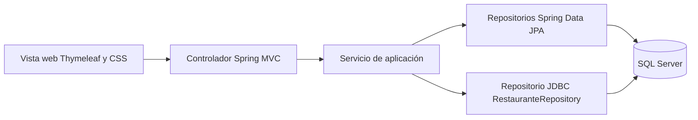

# Arquitectura de Mandale Carbón

## Flujo principal

## Responsabilidades

- **Vista:** presenta datos y formularios con Thymeleaf y estilos responsivos.
- **Controlador:** recibe solicitudes web, valida parámetros de entrada y selecciona la vista o redirección.
- **Servicio:** aplica reglas de negocio y coordina repositorios cuando el caso de uso lo requiere.
- **Repositorio/DAO:** persiste y consulta datos mediante Spring Data JPA o `JdbcTemplate`.
- **Base de datos:** SQL Server conserva usuarios, clientes, productos, pedidos, detalles, pagos y operaciones relacionadas.

## Relación con los principios evaluados

- **MVC:** controladores Spring MVC, vistas Thymeleaf y modelos Java separan la interacción, presentación y datos.
- **DAO:** los repositorios aíslan el acceso a datos. Spring Data JPA implementa los repositorios de entidades y `RestauranteRepository` concentra consultas JDBC.
- **Responsabilidad única:** las rutas están separadas por controlador y las reglas de negocio de clientes, pedidos, productos e inventario están en servicios.
- **Inversión de dependencias:** los servicios y controladores reciben repositorios por constructor, lo que permite sustituir dependencias por mocks en pruebas.

Este documento describe la arquitectura presente en el código; no afirma que todos los principios SOLID estén implementados en cada clase. Para la entrega, el equipo debe revisar y poder explicar las decisiones de diseño y las excepciones de acceso JDBC.
